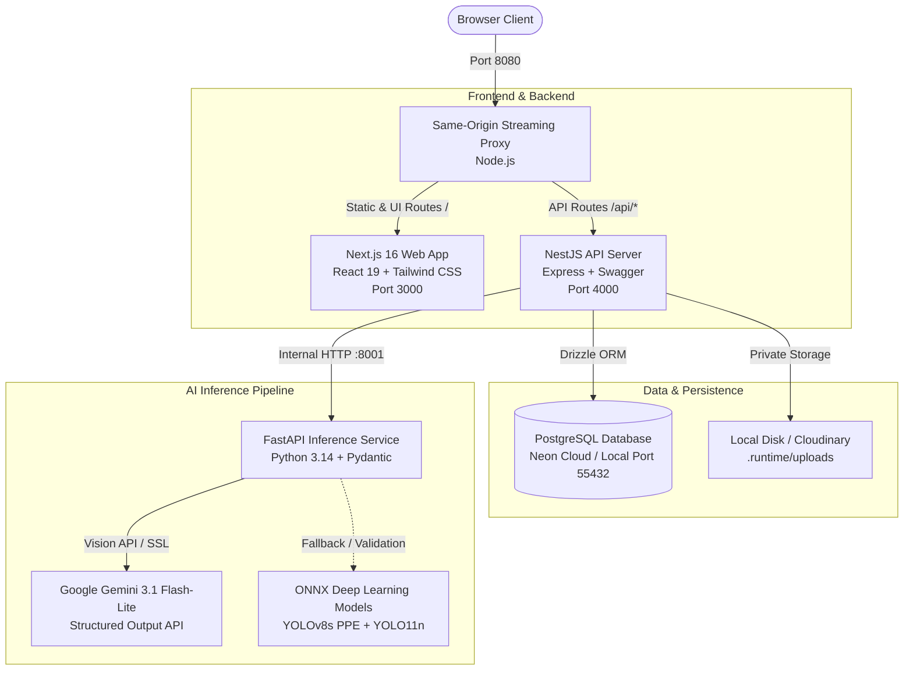

# SafeSight: AI-Powered Workplace Safety & PPE Inspection System

> An account-free, high-fidelity workplace safety and image inspection workspace with a nostalgic Windows 95 desktop interface. Powered by multimodal vision AI (Google Gemini 3.1 Flash-Lite) and local ONNX deep learning models.

---

## 📌 Project Overview

**SafeSight** is an automated visual safety inspection platform designed for industrial, construction, and manufacturing environments. Traditional safety compliance audits rely on manual, error-prone checklists or brittle computer-vision bounding-box models that hallucinate detections without contextual reasoning.

SafeSight solves this by coupling multimodal visual intelligence with rigorous evidence-based verification:

1. **Human PPE & Workwear Analysis**: Inventories each visible person, classifying gear into worn, carried, or uncertain states while actively distinguishing standard clothing from certified PPE (e.g., distinguishing welding helmets from hardhats, or safety vests from regular outerwear).
2. **Machinery Hazard & Safety Analysis**: Autonomously inspects visible industrial machinery to identify nip-points, rotating shafts, and operational hazards, provides phased safety precautions (Before Use, Operation, Maintenance, Emergency), and delivers dynamic operator PPE recommendations—including critical entanglement warnings (e.g., prohibiting gloves near rotating lathe chucks).
3. **Retro Windows 95 Desktop UI**: Delivers a full desktop environment with movable, resizable, stackable windows, Start menu, taskbar, localized pixel cursors, and system clock, eliminating cluttered web dashboards and SaaS account barriers.

---

## 🏗️ System Architecture



---

## 📂 Repository Directory Organization

```text
SafeSight/
├── apps/
│   ├── api/                      # NestJS backend API service
│   │   ├── src/                  # Controllers, services, auth, multer, worker
│   │   └── tsconfig.json         # API TypeScript configuration
│   └── web/                      # Next.js 16 React frontend application
│       ├── app/                  # App router pages (desktop, human, machinery, history)
│       ├── components/           # Windows 95 UI widgets, dialogs, taskbar, window manager
│       └── lib/                  # TanStack Query client, audio, retro themes
├── packages/
│   ├── contracts/                # Shared Zod schemas, TypeScript types, and validation rules
│   │   └── src/index.ts          # Strongly-typed data contracts between UI, API, and Inference
│   └── db/                       # Drizzle ORM database schemas and migration scripts
│       ├── migrations/           # SQL migration files
│       └── src/schema.ts         # PostgreSQL table definitions (inspections, sessions, facilities)
├── services/
│   └── inference/                # Python FastAPI vision inference service
│       ├── main.py               # FastAPI application endpoints
│       ├── vision.py             # Multimodal Gemini API adapter & evidence validator
│       ├── requirements.lock     # Python dependency lockfile
│       └── tests/                # Python unit tests for structured responses and errors
├── models/                       # Local pre-trained ONNX models
│   ├── ppe-safetyvision-v2.onnx  # SafetyVision YOLOv8s PPE detector (896x896)
│   └── person-yolo11n.onnx       # Ultralytics YOLO11n person detection model
├── scripts/                      # Operational and development automation scripts
│   ├── dev.mjs                   # Cross-platform development orchestrator
│   ├── migrate.ts                # Drizzle database migration runner
│   ├── seed.ts                   # Workspace and facility initialization script
│   ├── health.mjs                # Multi-service health-check probe
│   ├── proxy.mjs                 # Same-origin streaming HTTP/SSE reverse proxy
│   └── check-secrets.py          # Pre-commit secret scanning audit
├── infra/                        # Infrastructure and container orchestration
│   ├── compose.yaml              # Docker Compose definition for PostgreSQL
│   └── compose.full.yaml         # Full production multi-container deployment
├── docs/                         # Detailed architecture, UX research, and project reviews
│   ├── ARCHITECTURE.md           # System design and execution pipeline
│   ├── API.md                    # REST API endpoints and data schemas
│   ├── UX_RESEARCH.md            # OSHA/HSE human factors and Windows 95 UI research
│   └── EVALUATION.md             # Benchmark guidelines and evaluation metrics
├── tests/                        # Integration and end-to-end test suites
│   ├── api.test.ts               # API integration tests
│   ├── contracts.test.ts         # Shared contract and schema validation tests
│   └── browser/                  # Playwright browser automation tests
├── .env.example                  # Environment variable configuration template
├── package.json                  # Root monorepo workspace configuration
├── pnpm-workspace.yaml           # pnpm multi-package definitions
└── README.md                     # Project documentation
```

---

## 🛠️ Technology Stack

| Layer            | Technology           | Version              | Purpose                                                              |
| :--------------- | :------------------- | :------------------- | :------------------------------------------------------------------- |
| **Frontend**     | Next.js / React      | `16.3.8` / `19.3.0`  | Server-rendered desktop UI, window registry, TanStack Query          |
| **Styling**      | Tailwind CSS         | `4.1.17`             | Retro Windows 95 styling, pixelated icons, custom classic cursors    |
| **Backend API**  | NestJS / Express     | `12.1.2` / `5.1.0`   | REST API, background worker, session isolation, CSRF protection      |
| **Contracts**    | Zod / TypeScript     | `4.1.12` / `5.9.3`   | Shared runtime type safety across frontend, backend, and inference   |
| **Database**     | PostgreSQL / Drizzle | `0.45.3`             | Relational persistence, transactional job claiming (`SKIP LOCKED`)   |
| **Inference**    | FastAPI / Uvicorn    | `0.142.2` / `0.54.0` | High-performance Python microservice for AI vision queries           |
| **Vision AI**    | Google Gemini API    | `3.1-flash-lite`     | Multimodal scene understanding, hazard reasoning, structured output  |
| **Local Models** | ONNX Runtime         | YOLOv8 / YOLO11      | Edge object detection models for person and safety gear verification |
| **Proxy**        | Node.js HTTP Proxy   | Native               | Same-origin streaming proxy routing UI and API on port 8080          |

---

## 📋 System Prerequisites

Ensure the following tools are installed on your machine:

- **Node.js**: `v24.x` or `v26.x` (`v24.21.0`+ recommended)
- **pnpm**: `v12.8.x` (`corepack enable pnpm` or `npm install -g pnpm`)
- **Python**: `3.14.x` (or `3.10+`) with `pip`
- **PostgreSQL**: Cloud instance (e.g., [Neon](https://neon.tech), [Supabase](https://supabase.com)) OR local Docker / PostgreSQL instance.

---

## 🚀 Step-by-Step Installation & Setup

### 1. Clone the Repository

```bash
git clone https://github.com/<your-username>/SafeSight.git
cd SafeSight
```

### 2. Install Dependencies

Install all workspace dependencies across packages and applications:

```bash
pnpm install
```

Install Python inference dependencies:

```bash
pip install -r services/inference/requirements.lock
```

### 3. Configure Environment Variables

Copy the template configuration file:

```bash
cp .env.example .env
```

Open `.env` and configure your credentials:

1. **Google Gemini API Key**: Get a free API key from [Google AI Studio](https://aistudio.google.com/apikey) (keep billing disabled to stay on the free tier):
   ```dotenv
   GEMINI_API_KEY=your_gemini_api_key_here
   GEMINI_MODEL=gemini-3.1-flash-lite
   GEMINI_BASE_URL=https://generativelanguage.googleapis.com/v1beta
   ```
2. **PostgreSQL Database**:
   - _Cloud PostgreSQL (Recommended - Instant & Free)_: Create a free database on [Neon.tech](https://neon.tech) and paste the connection string:
     ```dotenv
     DATABASE_URL=postgresql://<user>:<password>@<host>/<dbname>?sslmode=require
     ```
   - _Docker PostgreSQL (Alternative)_: Start local container with `docker compose -f infra/compose.yaml up -d db`.

### 4. Initialize the Database

Apply schema migrations and seed initial workspace facilities:

```bash
pnpm db:migrate
pnpm db:seed
```

---

## 💻 Execution Steps (How to Run)

Start all services simultaneously with the unified development orchestrator:

```bash
pnpm dev
```

This starts:

- 🌐 **Same-Origin Proxy**: `http://127.0.0.1:8080` (Main Entrypoint)
- 🖥️ **Web UI**: `http://127.0.0.1:3000`
- 🔌 **API Backend**: `http://127.0.0.1:4000`
- 🧠 **FastAPI Inference**: `http://127.0.0.1:8001`

### Accessing SafeSight:

Open your browser and navigate to:
👉 **[http://localhost:8080](http://localhost:8080)**

---

## 🔍 Verification & Testing

Verify that all layers of the application are working correctly:

```bash
# 1. Typecheck all TypeScript code across the monorepo
pnpm typecheck

# 2. Run ESLint code quality and formatting checks
pnpm lint

# 3. Run contracts and Python inference unit tests
pnpm test

# 4. Probe live system health across proxy, web, and API
pnpm health

# 5. Check for accidental secret exposure in client bundles
python scripts/check-secrets.py
```

---

## 📊 Datasets, Pretrained Models, and Safety References

### Pretrained Deep Learning Models

- **SafetyVision YOLOv8s PPE Model**: Pretrained ONNX model fine-tuned for industrial PPE detection (Hardhats, Safety Vests, Gloves, Safety Glasses, Boots).
  - _Hugging Face Repository_: [ayushgupta7777/safetyvision-yolov8](https://huggingface.co/ayushgupta7777/safetyvision-yolov8)
- **Ultralytics YOLO11n**: High-efficiency person detection model.
  - _Model Source_: [Ultralytics YOLO11](https://github.com/ultralytics/ultralytics)
- **Google Gemini 3.1 Flash-Lite**: State-of-the-art vision-language foundation model utilized for zero-shot contextual reasoning and hazard identification.
  - _Documentation_: [Google Gemini Multimodal Vision API](https://ai.google.dev/gemini-api/docs/vision)

### Open Datasets for PPE & Industrial Safety

- **CPPE-5 (Crowd PPE Dataset)**: Contextual benchmark dataset for personal protective equipment detection.
  - _Dataset Link_: [Hugging Face keremberke/ppe-detection](https://huggingface.co/datasets/keremberke/ppe-detection)
- **Roboflow Universe PPE Datasets**: Curated collection of industrial safety equipment imagery across varied lighting and orientations.
  - _Dataset Link_: [Roboflow Universe PPE Search](https://universe.roboflow.com/search?q=ppe)

### Safety Regulations & Standards

- **OSHA 29 CFR 1910 Subpart I**: Occupational Safety and Health Administration standards on Personal Protective Equipment:
  - [OSHA 1910 Subpart I Regulations](https://www.osha.gov/laws-regs/regulations/standardnumber/1910/1910SubpartI)
- **OSHA 29 CFR 1910 Subpart O**: Machinery and Machine Guarding requirements:
  - [OSHA 1910 Subpart O Regulations](https://www.osha.gov/laws-regs/regulations/standardnumber/1910/1910SubpartO)
- **HSE UK PUWER**: Provision and Use of Work Equipment Regulations (1998):
  - [UK HSE PUWER Guidance](https://www.hse.gov.uk/work-equipment-machinery/puwer.htm)

---

## 👥 Authors & Academic Submission

- **Project Name**: SafeSight
- **Project Type**: Capstone / Final Project
- **Interface Specification**: Retro Windows 95 Desktop GUI & Multimodal Visual Safety Inspection
- **License**: MIT
